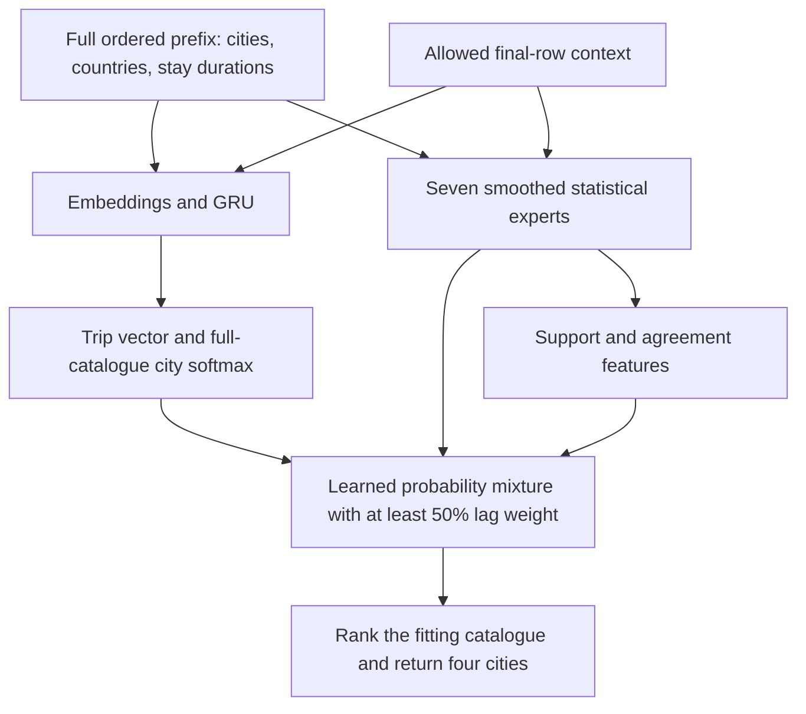

# Hybrid itinerary recommender

Predict the **final recorded city of a trip** from its full observed itinerary.
The model combines a **GRU sequence encoder**, **seven statistical experts** and
a **support-aware blending gate**, then returns four distinct cities.

**Public HitRate@4: 51.73% · NDCG@4: 42.00% · 70,662 trips.**

## Architecture



### 1. Inputs and representations

| Input | Representation |
|---|---|
| Entire visible itinerary | Ordered city IDs, hotel countries and stay durations; repeated visits retained, no truncation. |
| Stay token | City embedding (32), country embedding (8) and `log1p(nights)`, projected to width 32. |
| Sequence | One-layer GRU (width 32), supplemented by explicit first, last and penultimate stay vectors. |
| Final-row context | Booker country, device, affiliate, check-in month, weekday and stay nights; six embeddings of width 8. |
| Trip summaries | `log1p` of stay count, distinct-city count, mean nights, last-stay nights and total nights. |

A 64-unit ReLU layer with dropout 0.1 maps these features to a 32-dimensional
trip vector. Its dot products with the **shared input/output city embeddings**,
plus city biases, produce a softmax over the complete fitting catalogue.
Final city, final hotel country, user ID and trip ID are excluded from predictors.

### 2. Statistical experts

| Expert | Signal |
|---|---|
| Lag | Directed later-stay evidence from every prefix city, with lag buckets 1/2/3/4+ and recency weighting. |
| Terminal | How frequently each city is a true trip endpoint. |
| Origin | Final destination conditional on the first city. |
| Recent route | Final destination conditional on the last two cities jointly. |
| Visit return | Evidence for ending in a city already visited during this trip. |
| Origin return | Evidence for ending where the trip started. |
| Context | A context-based correction of the lag distribution. |

City start/end/prefix counts and return rates distinguish **city roles** from
general popularity. Count smoothing (strength 10) shrinks sparse evidence toward
broader priors. Every expert supplies a normalized full-catalogue distribution.

### 3. Support-aware blending

A regularized softmax gate uses **13 observable support/agreement features**:
prefix length, route/origin/pair counts, return/context evidence, city-role
evidence and expert agreement.

$$
p(c\mid x)=0.5\,p_{lag}(c\mid x)
+0.5\sum_e w_e(x)\,p_e(c\mid x).
$$

The residual mixture includes all seven statistical experts and the GRU.
Consequently, lag retains at least 50% weight. The gate minimizes destination
log loss with L2 penalty 0.01. Mean public weights are **50.00% lag, 48.36% GRU**
and 1.64% across the remaining experts.

### 4. Training and recommendation principles

- **Aligned target:** one true endpoint per eligible training trip; the same
  prefix and allowed-context semantics are used for training and prediction.
- **Leakage control:** development holds out whole users (80/20, seed 43).
  Three inner user folds generate out-of-fold expert probabilities for gate
  training; experts are then refitted on all fitting users.
- **Neural optimization:** categorical cross-entropy, AdamW, learning rate 0.001,
  weight decay 0.0001, batch size 128, 12 epochs, gradient clipping 5, seed 20261013.
- **Recommender design:** bookings are implicit positive feedback; behavioral
  sequence evidence and contextual experts form a hybrid. Return destinations
  remain eligible. Unknown inputs have reserved tokens, while cities absent
  from the fitting catalogue cannot be recommended.
- **Ranking:** score the full fitting catalogue, without sampled evaluation
  candidates or injected targets, and return the four highest-scoring distinct cities.

## Evaluation

| Population | Trips | Endpoint reference HitRate@4 | GRU blend HitRate@4 |
|---|---:|---:|---:|
| Development, user split | 43,647 | 49.18% | **50.37%** |
| Public benchmark | 70,662 | 50.52% | **51.73%** |

The GRU blend hits **36,553 public targets**, adding **854 hits (+1.21 percentage
points)** over the endpoint reference. The paired exploratory 95% gain interval
is **[+1.03, +1.40] pp**. Exact scores and provenance are in
[model_results.json](docs/model_results.json).

Public labels were previously inspected; these scores are descriptive, not an
independent test or official challenge placing. Anonymous cities lack distances and availability information;
offline endpoint accuracy does not establish online usefulness.

## Implementation

Three Python files follow the architecture above. Each has numbered sections and
a sequential execution block; [Makefile](Makefile) runs them in order.

| Stage | File | What to look for |
|---|---|---|
| 1. Data and features | [data_features.py](pipeline/data_features.py) | Local CSV loading, whole-user split, complete-trip cleaning, true endpoint labels, ordered prefixes, allowed context, unknown tokens and five neural summaries. |
| 2. Base recommender | [base_recommender.py](pipeline/base_recommender.py) | Seven experts, city roles, smoothed returns, recent-route interaction, context correction, 13 gate features, three user folds and the constrained mixture loss. |
| 3. GRU extension and evaluation | [gru_extension.py](pipeline/gru_extension.py) | Embeddings, GRU, shared city head, explicit AdamW training loop, eight-expert gate, full-catalogue prediction and base-versus-GRU metrics. |

Stage 1 splits users before preparing each partition. Stage 2 reads only fitting
partitions. Stage 3 trains the fold GRUs against exactly the same held-user rows
as the statistical experts, then refits on all fitting users. It alone opens
evaluation requests; public ground truth is read after prediction export.

Data preparation uses ordinary DataFrames. The only class, `ItineraryGRU`, defines
the PyTorch network. Folds and scaling use scikit-learn; sparse matrices, softmax
and optimization use SciPy. Raw data, weights and historical experiments stay local.

```bash
conda env create -f environment.yml
conda activate booking-recommender
make
```

The default run evaluates the whole-user development split. Put the official
CSV files in `data/multi-destination-trip-dataset/`:

```text
data/multi-destination-trip-dataset/
    train_set.csv
    test_set.csv
    ground_truth.csv
```

The file paths are declared at the top of the scripts. Intermediate training and
holdout DataFrames go to `data/processed/`. To run the stages individually:

```bash
python -m pipeline.data_features
python -m pipeline.base_recommender
python -m pipeline.gru_extension
```

To also refit on all training users and evaluate the public benchmark:

```bash
make PUBLIC=--public
```

Each phase fits three fold GRUs and one full-data GRU, using 12 epochs and four CPU
threads. Completed folds and networks reload from cache. `make EPOCHS=1` runs a
shorter training budget for smoke checks. When changing the training budget,
give both model stages the same fresh `--output-dir` to keep cached runs separate.
Predictions, metrics, training losses, mean gate weights and fold audits are
written under `results/gru_showcase/`. Metrics compare the base and GRU blend
using HitRate@4, NDCG@4 and paired user-cluster bootstrap intervals.

```bash
OMP_NUM_THREADS=1 OPENBLAS_NUM_THREADS=1 MKL_NUM_THREADS=1 python -m pytest tests/test_recommender.py -q
```

Tests run all three stages on local CSV fixtures and check filtering, user
separation, prefix/label boundaries, output schemas and cache reload. The recorded
model run used Python 3.10.6 and PyTorch 2.7.1 on CPU; the score above belongs to
the original full run.

Dataset: Goldenberg and Levin, *Booking.com Multi-Destination Trips Dataset*,
SIGIR 2021 ([paper](https://doi.org/10.1145/3404835.3463240),
[official data and terms](https://github.com/bookingcom/ml-dataset-mdt)).
The neural city head and GRU adapt ideas from
[NVIDIA's challenge solution](https://ceur-ws.org/Vol-2855/challenge_short_2.pdf).
